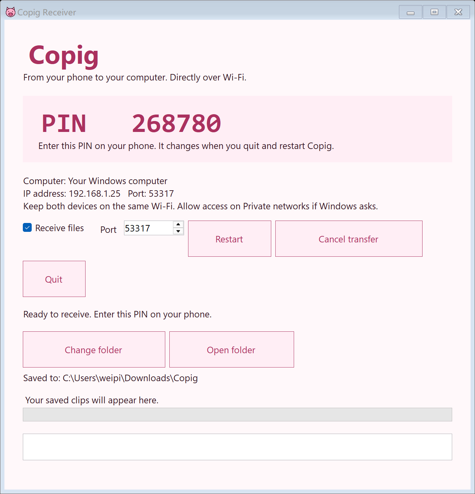

# Copig


Capture clips worth understanding, then send them directly from your Android phone to Windows over your local network.

Copig takes screenshots and records permitted screen video and playback audio from Douyin, WeChat Channels, browser media and other apps. A small pig button docks at the screen edge, expands when tapped, and shrinks after recording actions. Saved clips can be previewed, shared, exported or transferred to the Windows receiver for a learning workflow.

Version **0.5.0** adds full-resolution PNG screenshots and gives the Windows desktop pig icon a rounded rectangle background. See the recording-quality comparison test and desktop-shortcut instructions in the beginner guide.

To save a screenshot: tap the floating pig → **Screenshot** → approve **Entire screen** → return to your content → tap the pig → **Take screenshot**. The controls briefly disappear; the PNG is saved in Copig.

## Download and start

[Download Copig 0.5.0 for Android and Windows](https://github.com/WeipingWu2023/Cpig/releases/tag/v0.5.0) · [Detailed beginner guide](GETTING-STARTED.md) · [LAN setup and troubleshooting](LAN-TRANSFER.md)

| Download | Use |
| --- | --- |
| [Copig-debug.apk](https://github.com/WeipingWu2023/Cpig/releases/download/v0.5.0/Copig-debug.apk) | Android 10+ phone; tested target is Redmi Note 13 / Android 14 |
| [Copig-Receiver-Windows-x64.zip](https://github.com/WeipingWu2023/Cpig/releases/download/v0.5.0/Copig-Receiver-Windows-x64.zip) | Windows 10/11 x64; version 0.5.0 prevents duplicate receiver windows; runtime included |
| [SHA256SUMS.txt](https://github.com/WeipingWu2023/Cpig/releases/download/v0.5.0/SHA256SUMS.txt) | Verify the Android 0.5.0 APK and Windows 0.5.0 ZIP |

1. Install the release APK as an update over your existing Copy/Cpig/Copig installation. Keep the existing installation to retain private clips.
2. Open Copig, enable floating controls and allow display over other apps. Tap the pig to expand, tap **Record**, approve Android's capture dialog, return to your video and tap **Record now**. Nothing is recorded while **Ready**. Tap the pig again and **Stop** to save.
3. Extract the Windows ZIP and run **Copig Receiver.exe**. Allow access on your private network if Windows Firewall asks.
4. Connect both devices to the same router. On a saved clip, tap **Send to computer**, select the PC and enter the receiver's six-digit PIN. Completed files appear in **Downloads\Copig**, or the folder you select in Windows.

If discovery fails, use **Add computer by IP address** with the address shown on Windows. Full installation, recording, permission, transfer, building and testing instructions are in [GETTING-STARTED.md](GETTING-STARTED.md).

## Features

- Pink pig branding, system light/dark themes and a compact 48 dp overlay button that snaps to either edge after dragging.
- Explicit **Ready → Record now** workflow, fresh Android capture consent, stop/save controls and a local clip library.
- Preview, share, export, delete and import supported audio/video files and PNG images. Video captures are saved as MP4 and screenshots as PNG; URL downloads are outside this release.
- Automatic LAN discovery, manual IPv4 fallback, certificate-pinned HTTPS, receiver PIN, transfer progress and cancellation.
- Windows folder selection, tray operation and safe completed-file promotion after length/SHA-256 validation. Duplicate names preserve existing files.

The app was previously called Copy/Cpig. Its Android package ID remains `app.copy` for update compatibility; this repository keeps its existing `Cpig` URL.

## Windows receiver



The preview uses example connection details. Use the PIN and IP displayed by your running receiver.

## Build from source

Android uses Kotlin, Jetpack Compose, MVVM and separate `app`, `domain` and `data` modules. Open the repository in Android Studio with JDK 17, Android SDK Platform 35 and Build Tools 35.0.0. Gradle 8.11.1 and library versions are pinned.

```powershell
.\gradlew.bat :app:assembleDebug :app:testDebugUnitTest :data:testDebugUnitTest :domain:test :app:lintDebug :data:lintDebug
```

The APK is produced at `app/build/outputs/apk/debug/app-debug.apk`. Set `JAVA_HOME` and `ANDROID_HOME`, or use Android Studio's SDK/JDK settings. Do not use `--offline` for a fresh clone until dependencies have been downloaded. If official Maven downloads stall, add `-Pcopy.useRepositoryMirror=true` to opt into the configured Aliyun mirrors.

The original signing key and local `.tools` directory are excluded from GitHub. A source build uses your own debug key and usually cannot update the published APK. For existing installations, use the release APK. Export important clips before switching to an APK with a different key. `build-local.ps1` is a convenience for the prepared development workspace; it does not install the toolchain.

For Windows, install the .NET 10 SDK and run:

```powershell
.\windows\build-windows.ps1
.\windows\test-receiver.ps1
```

This creates a runtime-included x64 ZIP. See [Windows build instructions](windows/README.md) and [the beginner guide](GETTING-STARTED.md) for fresh-clone setup. Neither the `.tools` runtimes nor generated build folders are stored in Git.

## Verification and practical limits

[TESTING.md](TESTING.md) records the 0.5.0 build, 19 JVM tests, lint with zero errors, APK signing/alignment, 28 receiver checks and six actual Android HTTPS interoperability checks, including a PNG screenshot transfer. The rounded rectangle EXE pig icon and desktop shortcut were also verified. UDP discovery was skipped while an existing receiver was active. Screenshot capture, overlay exclusion, higher-quality recording and the remaining heavy-blur diagnosis need the phone checks in the guide. The downloadable APK is a debug test build; the Windows executable is unsigned.


Android requires permission for each capture session. Source apps can block playback audio or protect video, so capture is not guaranteed for every app or item. Single-app capture on Android 14 gives cleaner output; full-screen capture can include the overlay. Copig captures eligible playback audio, not the microphone, and cannot include content played before recording started. Captures are capped at 15 minutes, with a 1280-pixel long edge and storage checks.

Only clips you choose are transferred. LAN transfers do not need a cloud account or Internet connection. The Windows receiver must be running and reachable on your network. Guest Wi-Fi/client isolation, VPN routing and firewalls can prevent discovery or connection.

No integrated AI provider or automatic cloud upload is included. Share/export a clip to a workflow that accepts its media format; receiving apps determine which files they support. **Copy learning prompt** provides a beginner explanation prompt separately.

## Project guide

- [Beginner installation, use, source builds and acceptance checks](GETTING-STARTED.md)
- [LAN transfer setup and troubleshooting](LAN-TRANSFER.md)
- [Windows receiver](windows/README.md)
- [Build/test evidence and checksums](TESTING.md)
- [Architecture and module boundaries](ARCHITECTURE.md)
- [Product mission and learning workflow](PRODUCT.md)
- [Original Cpig promotional poster](design/cpig-poster.png) and [art brief](design/cpig-poster-prompt.md)

## References

- [Android MediaProjection](https://developer.android.com/media/grow/media-projection)
- [Android playback capture](https://developer.android.com/media/platform/av-capture)
- [LocalSend protocol v2.2](https://github.com/localsend/protocol): Copig independently implements its discovery/upload routes. It is not affiliated with LocalSend, and browser download sharing/Windows-to-phone reception are outside this release.
