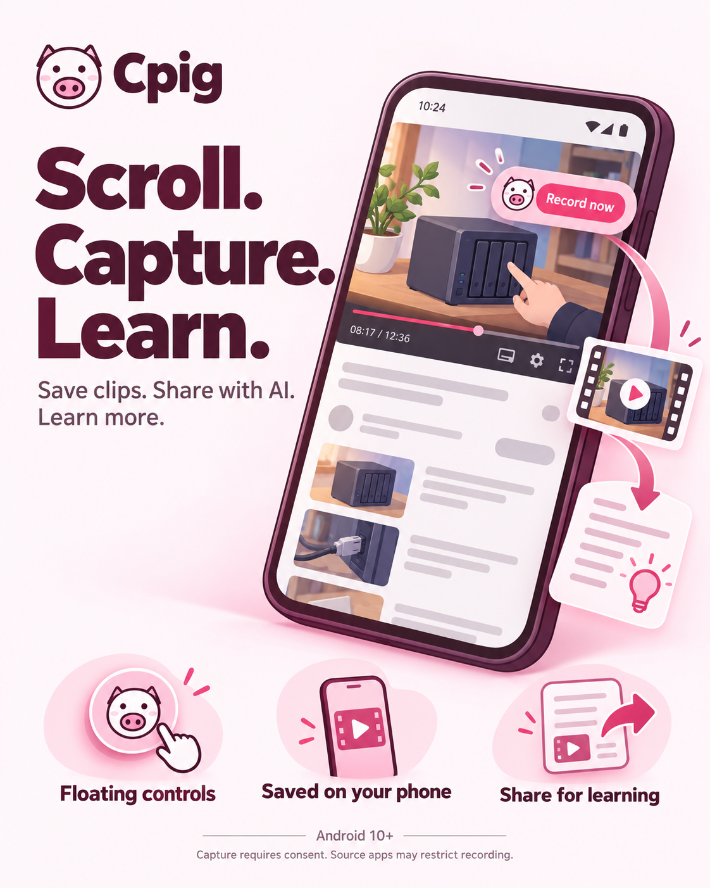

# Cpig

**Scroll. Capture. Learn.**

Cpig is an Android floating recorder for clips worth understanding. Capture permitted screen video and playback audio, keep clips on your phone, then preview and export/share them with a compatible AI tool for deeper learning.

- **Floating controls:** start and stop from the content you are browsing. Approve capture, return to your video, then tap **Record now** when you are ready.
- **Saved on your phone:** recordings stay local until you share or export them.
- **Share for learning:** send a supported media file to your chosen AI workflow to explain ideas, terms and prerequisites.

Android 10+. Capture requires consent for every session; source apps may restrict screen or playback-audio recording. Receiving apps determine which media types they accept. The poster uses an illustrative phone interface.

## Artwork

- [Promotional poster](design/cpig-poster.png)
- [Pig icon](design/cpig-icon.png)
- [Generation brief and exact copy](design/cpig-poster-prompt.md)

This repository contains Cpig's promotional artwork and brand assets. The poster was created with the built-in image generation tool using the existing Cpig pig icon as a reference.
